# Postgresto

Postgresto is a configurable data browser \ administration UI for [PostgREST](https://postgrest.org/). It supports relational tables but mainly targeted for document-style tables built around `jsonb`. I got tired of managing scripts in DBeaver, wanted something higher-level, so i came up with this bit of AI slopware to make my life easier.

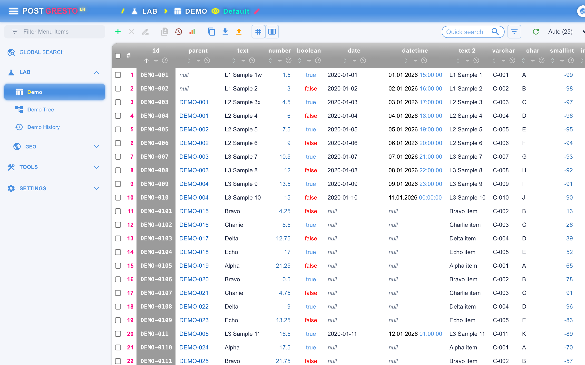

## Quickstart

The deployment package includes the prebuilt UI and deployment files. Optionally edit `.env` (the defaults launch with a sample database), then start the Docker Compose stack:

```bash
docker compose up
```

The stack initializes Postgres, applies Liquibase migrations, starts PostgREST, and serves the UI through nginx. Default url: `http://localhost:7777/postgresto/`.

## Features

- **View configuration**
  - Discover database tables and its structure, dig beyond json fields
  - Create mapped table views and hierarchical trees

  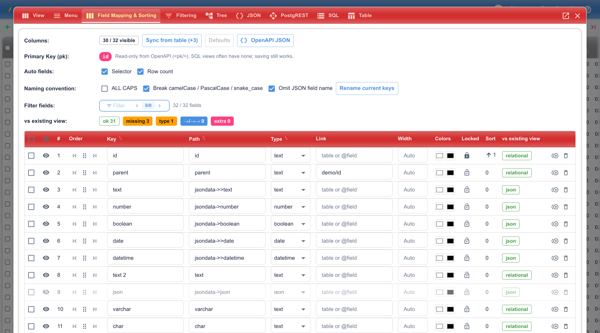
  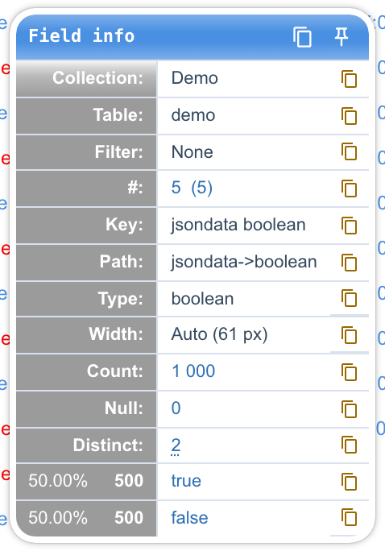
  
- **Table views**
  - Browse records with pagination and quick search
  - Filter builder pane
  - Inline field stats and bulk actions
  - Grid edit mode
  - Import and export data in Excel, CSV, JSON and SQL formats
  - Reasonably touchscreen friendly

  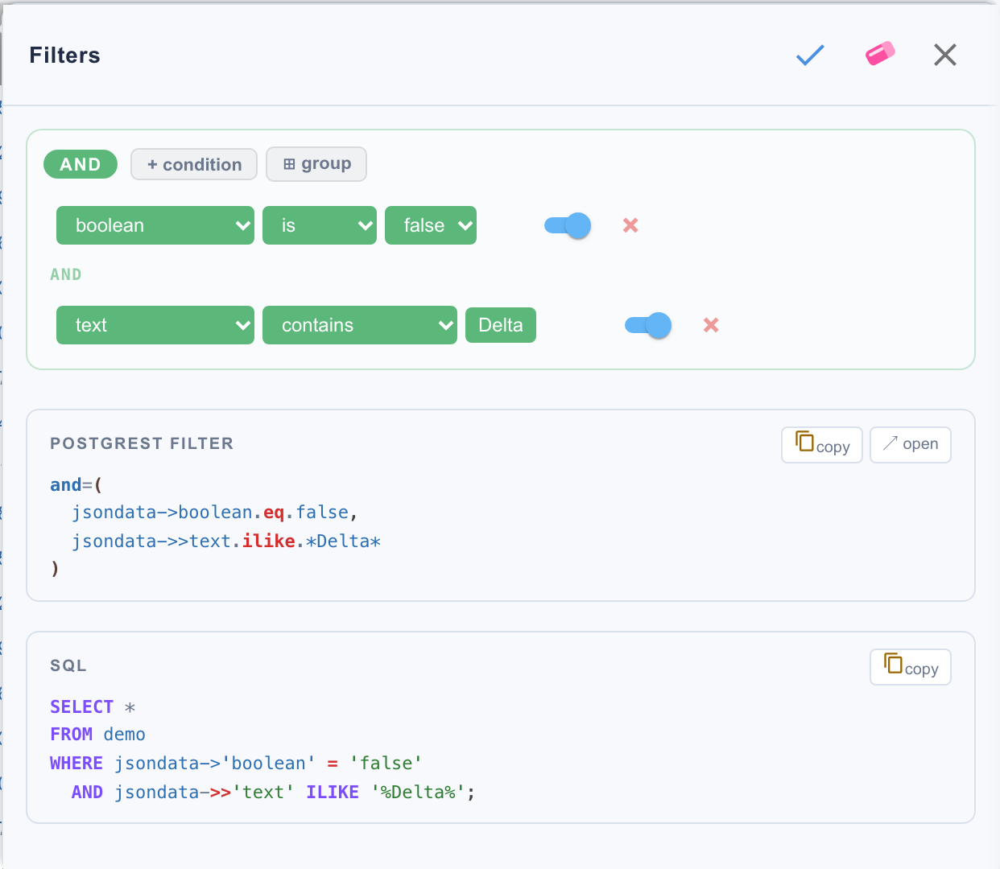
  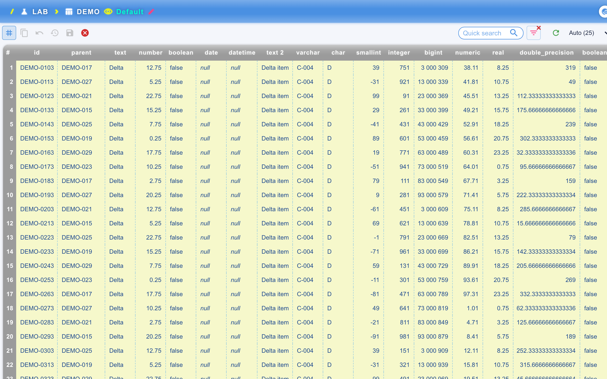
  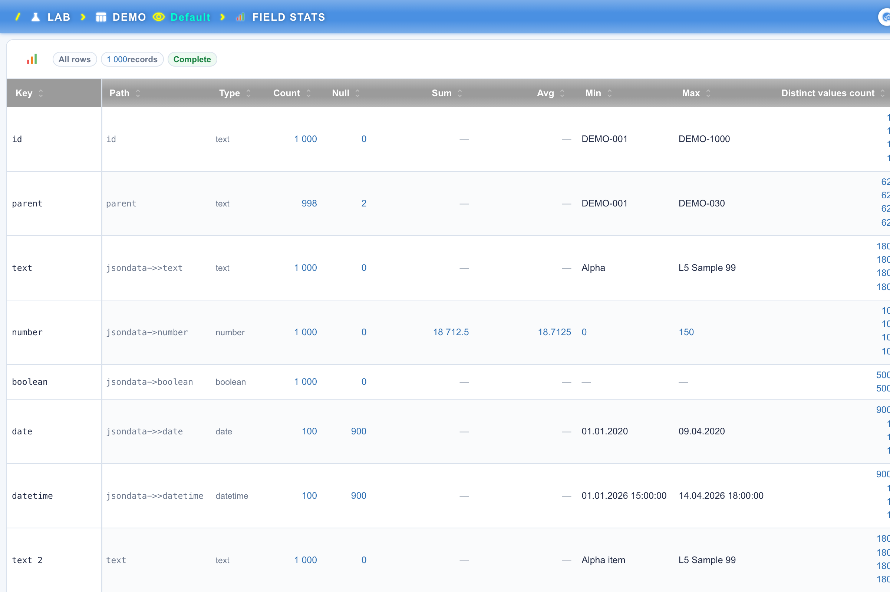
  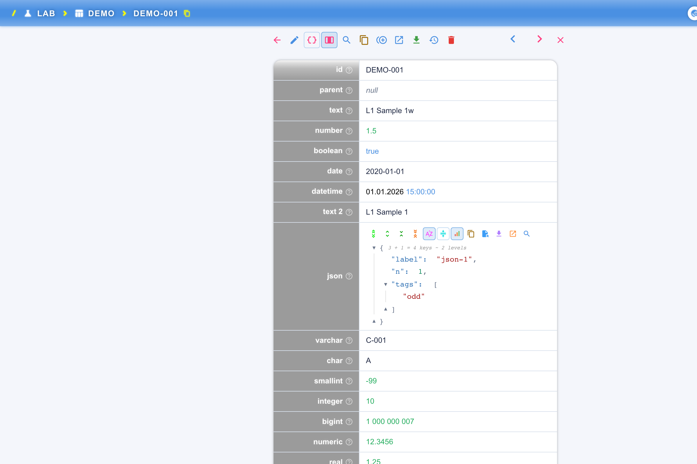
  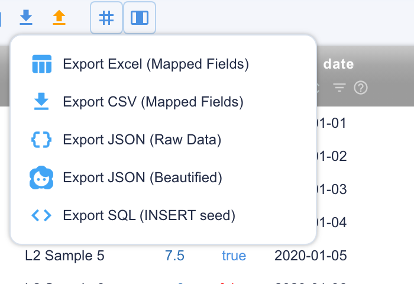
  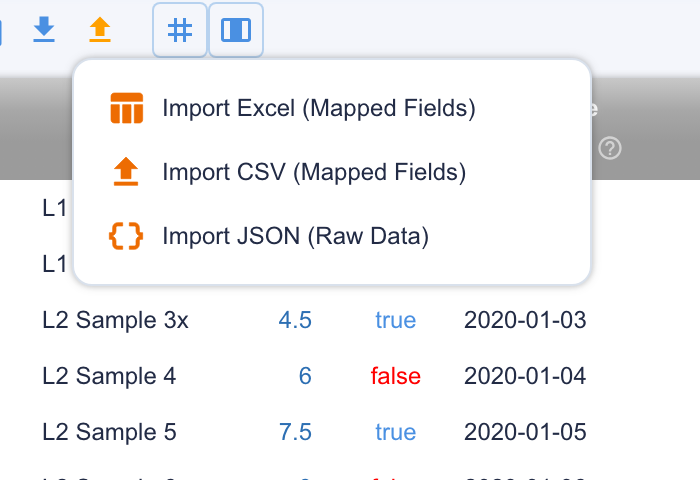

- **Hierarchy views**
  - Display recursive or fixed-level tree views.
  - search/filter/filter out control (click the icon to change mode)
  - Level selector and stats

  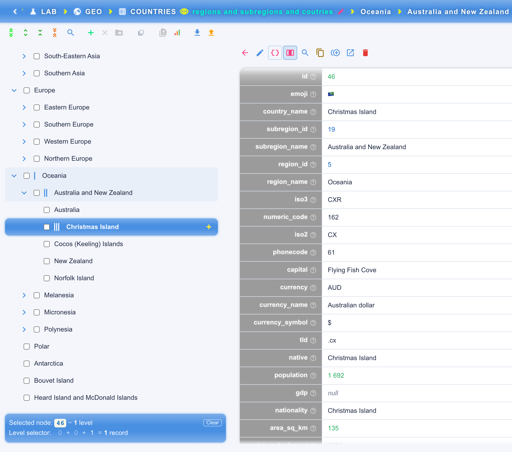

- **Table history**
  - Configure history tables for selected tables
  - Track inserts, updates, and deletes, with timestamps and user when available
  - Compare versions, with changed fields and their old/new values highlighted
  - Find past changes by table, record, date, or user

- **Global search**
  - PostgreSQL full-text search (`tsvector` / `tsquery`) across selected tables and configured fields
  - JSON search is currently implemented only for the `jsondata` field when its type is `jsonb`
  - Weighted fields, so matches in important fields rank higher
  - Language-aware stemming, phrase search, and boolean operators
  - Relevance ranking with highlighted snippets
  - GIN indexes for speed on large datasets

  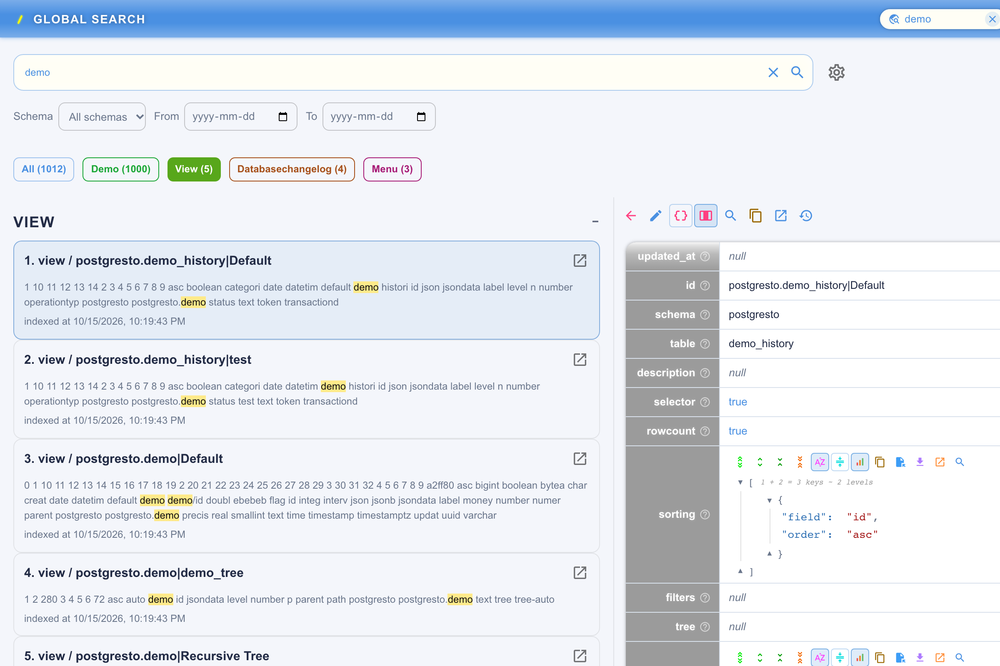

- **Navigation and appearance**
  - Configurable side menu and breadcrumbs
  - Cascading breadcrumb menus for menu sections, views, and hierarchy levels
  - Selectable themes

  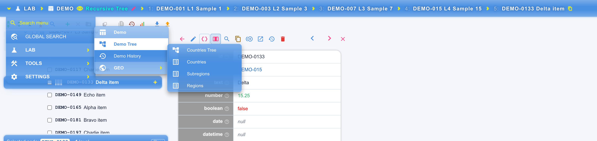
  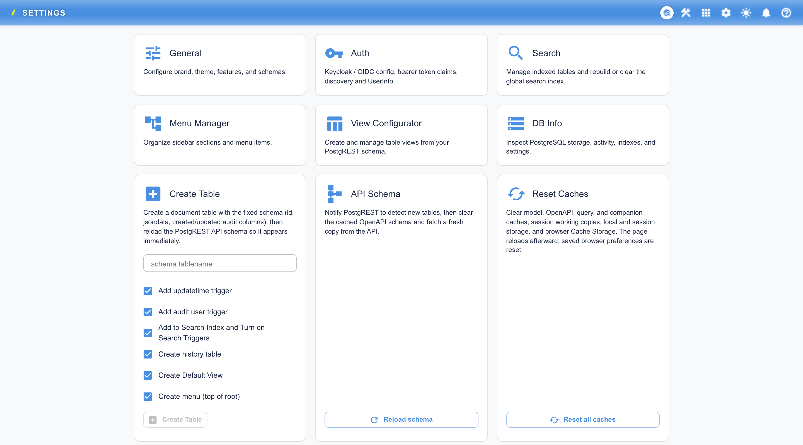

- **Additional tools**
  - **JSON Viewer** — inspect JSON in a readable, collapsible tree.
  - **DB Info** — useful database queries in one place, including `pg_stat_statements`.
  
  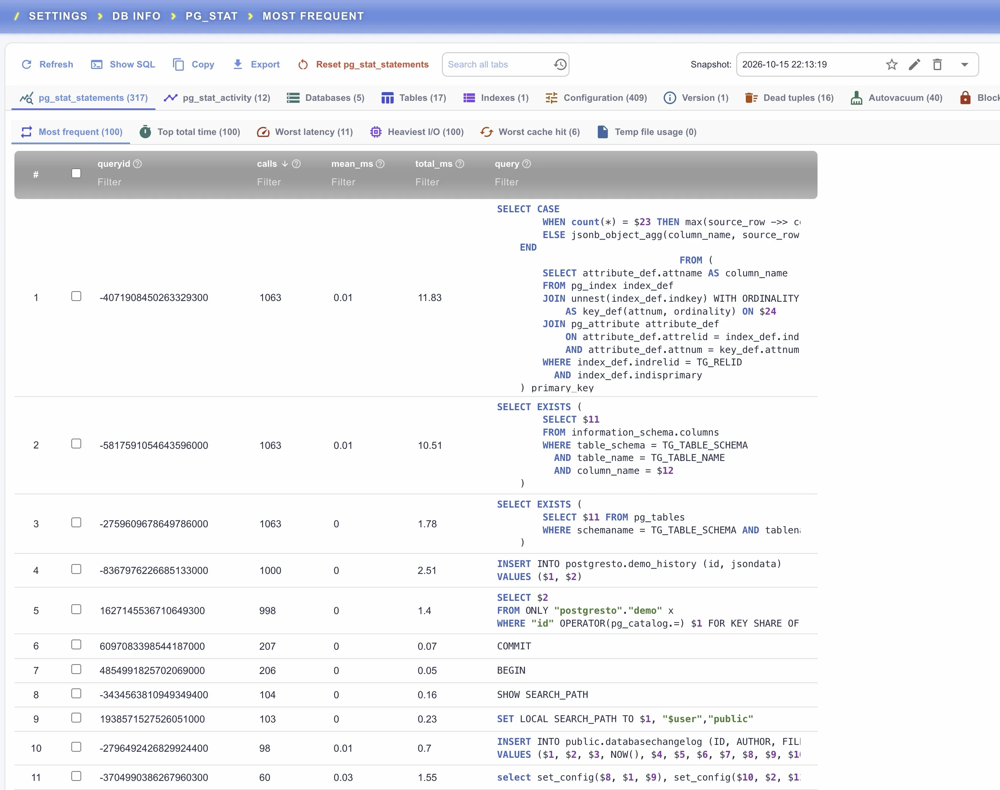

  - **Decoder** — encode, decode, and convert URL, JSON, XML, YAML, Base64, hex, HTML entities, Unicode escapes, UTF-8/16/32, and binary. It can also decode JWTs and automatically detect input formats.

  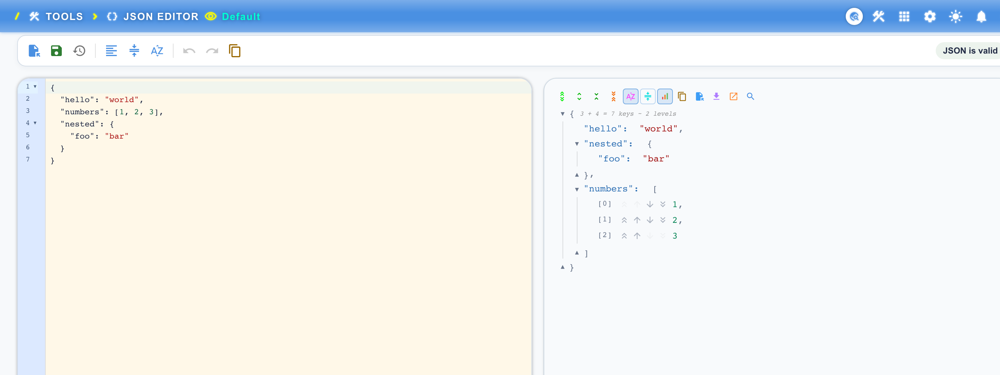

- **Authentication:** optionally use OpenID Connect sign-in and PostgREST JWT validation.

## Built with

- [PostgREST](https://postgrest.org/): REST API served straight from the Postgres schema
- [PostgreSQL](https://www.postgresql.org/): storage, JSONB, full-text search
- [Liquibase](https://www.liquibase.com/): schema and seed migrations
- [nginx](https://nginx.org/): serves the UI and proxies the API

## Demo data

The demo geo tables use geographic data from [dr5hn/countries-states-cities-database](https://github.com/dr5hn/countries-states-cities-database) (countries, states, cities). Credit and license terms belong to that project.

## Reference docs

- [App and API URLs](docs/urls.md)
- [Field types](docs/field-types.md)
- [PostgREST setup](docs/postgrest.md)
- [Authentication](docs/authentication.md)
- [Liquibase](docs/liquibase.md)

## Shortcuts

| Context           | Keys  | Action                       |
| ----------------- | ----- | ---------------------------- |
| List              | ← / → | Previous / next page         |
| List              | ↑ / ↓ | First / last page            |
| Record form       | ← / → | Previous / next record       |
| Tree              | ↑ / ↓ | Previous / next visible node |
| Tree record panel | ← / → | Previous / next record       |

Shortcuts are paused while editing inputs or table cells.

For trees - click and hold to select/expand all sublevels.

---

Wishmaking meatbag behind this can be reached here: https://github.com/voronczoff/postgresto
