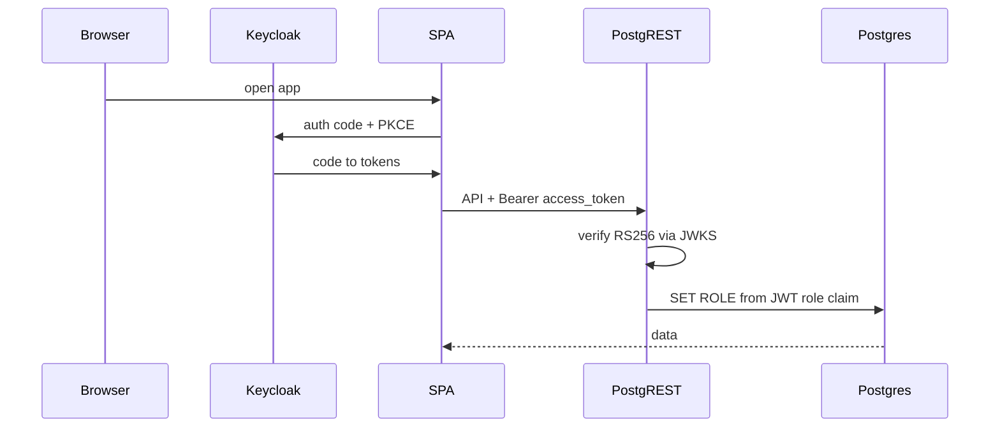

# Authentication (Keycloak + PostgREST)

Postgresto uses **OpenID Connect (authorization code + PKCE)** in the SPA and **JWT verification** in PostgREST. The access token’s `role` claim selects a Postgres role.



## Keycloak client

Lab setup (realm `master`, public client `common`):

| Setting | Value |
| --- | --- |
| Authority | `https://keycloak/realms/master` |
| Client ID | `common` |
| Access type | Public (no client secret in the browser) |
| Standard flow | On (authorization code) |
| PKCE | `S256` |
| Redirect URIs | `http://localhost:7777/postgresto/*` (+ deploy origins) |
| Web origins | Matching app origins |
| Post-logout redirect URIs | Same pattern as redirects |

**Required protocol mapper** on client `common` (hardcoded claim):

| Claim | Value | Token |
| --- | --- | --- |
| `role` | `authenticated` | Access token (and ideally ID/userinfo) |

PostgREST expects a **top-level string** `role`. Keycloak’s `realm_access.roles` array is not enough.

OIDC discovery:

`https://keycloak/realms/master/.well-known/openid-configuration`

## Environment

Set these values in the deployment package's `.env` file:

```bash
# Leave VITE_OIDC_AUTHORITY empty to disable the login gate
VITE_OIDC_AUTHORITY=https://keycloak/realms/master
VITE_OIDC_CLIENT_ID=common

# PostgREST — JWKS JSON must be single-quoted so bash keeps the quotes
PGRST_DB_ANON_ROLE=postgres
PGRST_JWT_ROLE_CLAIM_KEY=$.role
PGRST_JWT_SECRET='{"keys":[{"kid":"...","kty":"RSA","alg":"RS256","use":"sig","n":"...","e":"AQAB"}]}'
```

At deployment, OIDC settings are applied to the supplied UI, alongside
`VITE_BASE_PATH`:

- **Docker nginx** injects `<meta name="postgresto-oidc-authority">` and
  `postgresto-oidc-client-id` from compose `.env` (with `<base href>`).
- **Other hosts:** configure equivalent base-path and OIDC meta values in the
  web server's HTML response. Clear the OIDC values to turn the login gate off.

To change authentication, update `.env` and restart nginx/Compose. Keep
`PGRST_JWT_SECRET` in sync (API JWT is independent).

Refresh `PGRST_JWT_SECRET` from the realm JWKS when keys rotate:

`https://keycloak/realms/master/protocol/openid-connect/certs`

Prefer the **RS256 `use: sig`** key (or the full JWKS). Docker Compose enables JWT verification only when `PGRST_JWT_SECRET` is non-empty. The default no-token role is **`postgres`** (not `anon`); use `PGRST_DB_ANON_ROLE=anon` if you want locked-down anonymous access.

If tokens fail with audience errors, set `PGRST_JWT_AUD` to match the token `aud` (often `account`).

## Postgres roles

| Role | Login | Purpose |
| --- | --- | --- |
| DB URI user / default anon (e.g. `postgres`) | yes | PostgREST connection; also default when no JWT |
| `anon` | no | Optional locked-down no-JWT role (`PGRST_DB_ANON_ROLE=anon`) |
| `authenticated` | no | Requests with JWT `role=authenticated` |

The deployment migration service applies the role and permission changes. For
an externally managed database, apply the Liquibase changes supplied with the
deployment package.

When OIDC is enabled, the app shows an account menu with profile and sign-out
actions. The access token is sent to PostgREST as a Bearer token.

Redirect / silent renew URIs (under `VITE_BASE_PATH`):

- `{origin}{base}/auth/callback`
- `{origin}{base}/auth/silent-renew`

Register each deployment origin in the Keycloak client's Valid redirect URIs
and Web origins, using the callback paths above (for example,
`http://localhost:7777/postgresto/*`).

Use HTTPS for deployed hosts. Browsers restrict Web Crypto on non-secure HTTP
origins, which can affect PKCE sign-in.

Silent renew uses the refresh token about **60 seconds before** access-token
expiry. Lab Keycloak realm settings for ~once/day renew:

| Realm setting | Value |
| --- | --- |
| Access Token Lifespan | `86400` (24h) |
| SSO Session Idle | `86400` |
| SSO Session Max | ≥ `86400` |
| Client Session Idle / Max | `86400` |

If access-token lifespan ≤ the SPA notification window, the client refresh-loops.

On HTTP `401`, the client tries silent renew once, then redirects to Keycloak.

## Audit columns (`created_by` / `updated_by`)

Document tables attach `BEFORE INSERT OR UPDATE` → `postgresto.set_audit_user()`.
When a Bearer JWT is present, the trigger sets both columns from the token’s
**`preferred_username`** claim (Keycloak login) and ignores any client-supplied
values. On UPDATE it always preserves `created_by`. Without JWT (Liquibase seeds
/ open lab anon), seed or client values are left alone.

Manage with `postgresto.manage_audit_user(schema, table [, enabled])` (same
pattern as `manage_update_timestamp`). New tables from
`create_document_table` get the trigger automatically.

The app omits `created_by` / `updated_by` / `updated_at` from write payloads and
shows them read-only in record details.

## Verify

1. Open `http://localhost:7777/postgresto/` → Keycloak login → back into the app.
2. DevTools Network: PostgREST calls include `Authorization: Bearer …`.
3. With a valid token (`role=authenticated`) → runs as `authenticated`.
4. No Bearer → runs as `postgres` (default `PGRST_DB_ANON_ROLE`).
5. Create/update a row with a forged `created_by` in the body → stored value is still JWT `preferred_username`.

Example (PostgREST on `:3000`):

```bash
# no token → postgres (default anon role)
curl -sS -H "Accept-Profile: postgresto" "http://127.0.0.1:3000/config?select=id&limit=1"

# with Bearer → authenticated
curl -sS -H "Accept-Profile: postgresto" -H "Authorization: Bearer $ACCESS_TOKEN" \
  "http://127.0.0.1:3000/config?select=id&limit=1"
```

## Out of scope (for now)

- Row-level security from `request.jwt.claims`
- Dedicated app realm (leave `master` for lab only)
- Multiple Keycloak roles mapped to multiple Postgres roles
